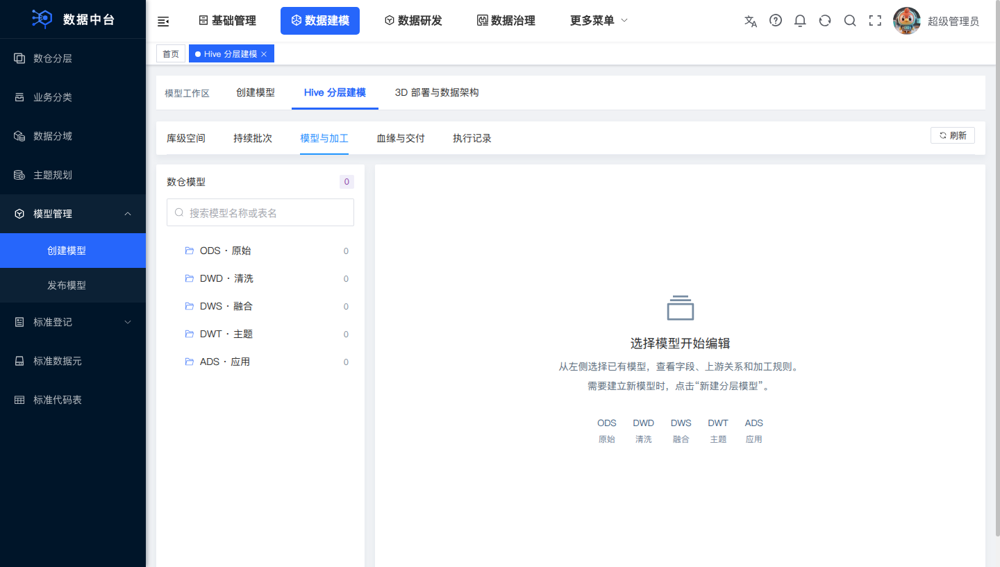
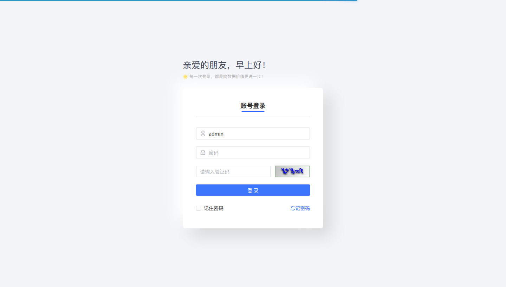

# Linux / JDK 21 全新部署验收记录

2026-10-12，使用 GitHub 确切提交 `32ed19157837a8345c65e994c485a55010da3807`，在 Linux 测试机独立安装 qData。主平台、质量与 AI 整体启动、身份权限、DataX 和浏览器操作已验证通过。

## 同日清洁 SQL 新装补验（当前默认）

用户要求默认系统不带测试内容后，`f3da9080328dfa154f6ad605bf5d9ef7dca8b0f5` 移除了 14 张没有运行引用的历史示例表，并去掉全部旧自增起点；规则/字典/菜单的 1,038 条功能种子内容不变，操作人统一为 `bootstrap`、时间为本次安装。下方 217 表记录属于此前版本，当前默认新装为 **203 表**。

该提交从 GitHub 下载后，在 `/data/qdata-gh-clean-20261012` 新实例实际安装 exit0。Java、前端和构建代码与已验证的 `32ed191` 相同，本次使用相同 manifest 核验过的产物，独立执行新的 SQL 和安装器；没有重复编译未改动的 Java 代码。

- 安装器 20 项测试通过，包括业务测试行、额外账号、遗漏表和修改 SQL 的拒绝检查。
- 服务启动前，203 表集合与源码一致；17 张系统种子表符合精确行数，其他 186 张业务/运行记录表全部为 0。
- 主平台、质量和 AI 正常启动，验证码、真实 HTML/41 入口资源、质量 SQL 健康与 AI 匿名 401 门禁通过。
- Linux Chromium 5 个实际检查通过：登录、五层标签与刷新、架构 2D、资产查询/重置、头像退出确认与返回登录页。
- 启动和浏览器检查后，再次只读核对全部表：连接、模型、资产、任务、API、AI 模型/会话/消息等业务表仍全部为空，系统仅新增 2 条正常登录/退出审计记录。没有执行合成数据验收工具。

本轮仅调整仓库新装 SQL 和保护检查，不向旧实例执行删除、清空或升级 SQL。旧测试对象与原生产保留，Hive/HDFS 未访问。初始化边界见[新装数据范围](DEPLOYMENT.md#新装数据范围)。

## 来源与部署方式

- 从 GitHub 下载该提交的 4,117 个文件，逐文件 SHA-256 与审核后的本机提交一致。
- 源码压缩包 SHA-256：`364023943d68018ae9a2b2cd8be3d60f13a01b863f8b8e94cfd079e0d2b09a2d`。
- 环境：Ubuntu 20.04 x86_64，JDK 21.0.10、Maven 3.9.15、Node.js 22.12.0、systemd、Docker Engine。
- 测试机无外网出口，使用下载的 GitHub 源码和公共第三方依赖离线包。构建前不存在 `target`；依赖包不含旧 `tech/qiantong` 内部模块。
- 全部主工程 49 个模块及独立 AI 3 个模块均从这份源码清洁构建。
- 使用该提交的安装器、四份初始化 SQL 和新产物，按[部署教程](DEPLOYMENT.md)的独立构建后安装流程完成新空库安装；生成独立凭据、配置与系统用户。
- 原生产服务继续运行，JAR 未替换。新实例和失败尝试的 MySQL 数据、日志、工具及配置均保留；未删除或覆盖 Hive/HDFS 数据。

## 验证结果

| 项目 | 结果与范围 |
|---|---|
| 源码构建 | 52 个模块通过；7 个构建产物与 manifest 的 SHA 一致，4 个安装 JAR 与新构建一致 |
| 初始化 | 测试对象创建前为 217 张表、433 个菜单、1 个初始管理员、ODS/DWD/DWS/DWT/ADS 五层目录 |
| 服务启动 | 主平台、质量、AI 三个真实 Spring 服务正常；质量 HTTP 健康检查包含实际 MySQL 查询；AI 实际 HTTP 鉴权门禁通过 |
| 字体与前端 | 验证码渲染正常；真实登录 HTML 和 41 个入口 JS/CSS 返回正确内容与 MIME |
| 安装器测试 | 15 项配置、密钥一致性及保护检查通过 |
| 认证单元测试 | 8 项通过，包括正确密码、验证码错误/缺失/过期/重放及禁用配置的行为 |
| Redis 原子消费 | 使用实际序列化器，16 路同时消费仅 1 路获得答案；真实两个登录请求使用同一验证码仅签发 1 个 Token |
| 基础依赖与登录 | 24 项实测通过，包含 MySQL 初始化、Redis AUTH、RabbitMQ AMQP 认证与 vhost、Neo4j 认证查询及验证码正反检查 |
| 真实 AI 会话权限 | 32 项 HTTP 检查通过：主平台实际登录 Token 通过共享 Redis 访问 AI；普通用户自身 GET/PUT 200、跨用户 403、匿名 401；主平台退出后两服务旧 Token 都被拒绝 |
| 实际数据源权限 | 完整 AI Spring 上下文、实际登录会话和 MySQL；普通项目成员读取实际数据源及两列，非成员无法读取连接或列；配置中的密码由实际工厂解密 |
| 独立 AI 权限回归 | 55 项 HTTP 断言通过；此套 Redis/数据库边界使用测试对象，与上述真实实例结果分别记录 |
| DataX | 官方 202309 包 SHA 校验通过；新实例非 root 服务用户使用 JDK 21/Python 3 执行 streamreader→streamwriter，5 行、135 字节、0 错误、退出码 0 |
| 浏览器 | Linux Chromium 实际填写并点击登录；五层目录/库级空间/批次标签及刷新、架构视图和 2D 切换、资产查询与重置、右上角头像退出与确认，返回登录页；5 个检查通过 |

权限与数据源专项的合成 MySQL 表、项目、连接、成员和会话均保留。这里的五层初始化是 qData 目录；新实例的 Hive 物理库绑定仍按教程登记已有集群。

实际新装浏览器截图（空工作区是新实例初始状态）：

## 本次修复

- 补齐完整初始化库、公开配置模板、源码构建、Linux 安装和离线准备工具，消除没有活跃调用的私有 JAR 构建依赖。
- 将前端放入实际 Thymeleaf `dist/admin` 模板路径，修复接口可用而浏览器登录页 500。
- 补齐验证码 UI 与启用时的后端校验，使用兼容 Redis 的原子消费；后端 RSA 与浏览器兼容密钥分别管理。
- 修复 AI 匿名访问、固定用户身份和缺会话归属检查；普通用户自身会话不再被不存在的菜单权限拦住。
- 收敛 AI 的独立 Spring 组件范围，避免加载主平台治理、资产及调度依赖；实际只读数据源适配器保留项目权限和真实 JDBC 元数据读取。数仓建表及任务操作仍由主平台执行。
- 修复 Boolean 字段错误使用 `@Size` 导致的请求校验失败，并补齐安装器真实 HTML、质量 SQL 和 AI HTTP 启动检查。

早期提交 `5168061` 的完整安装因 AI 组件依赖缺失未通过。其失败日志和实例保留；上述通过结果属于修复后的 `32ed191`。

## 安装产物指纹

| 文件 | SHA-256 |
|---|---|
| qdata-server.jar | `78497fa39517125ffdb1c2e28dc556d01de9569469f81b23c9d9883200b0f64f` |
| qdata-service-quality.jar | `ec0a0ebae1cb5392226886d329fe4c437ee9c4144d24304df9d2d793a827944d` |
| qdata-executor-etl.jar | `c5aa91d7ae9cb2b1f71f6d7bb9b9376f58b3ee357fa444dabf7eab490a981dfa` |
| qdata-ai-server.jar | `d0752edbd6614e4d5f8d5ddffe9a9bf5d03a7cc01325540729eb4237fca86ad2` |

不同日期重新构建可能产生不同 JAR SHA；部署时以自己那次构建的 manifest 为准。

## 可复跑工具与验收边界

安装与外部集群配置见[完整部署教程](DEPLOYMENT.md)。AI 权限、真实数据源及 Redis 工具见[测试说明](../deploy/tests/README.md)。`deploy/tests/browser_smoke.py` 对自己的隔离实例运行实际浏览器点击；需要相应 Linux WebDriver 和受保护的验收凭据。

本轮没有在新实例重跑 Hive 五库→Doris→OAuth API 的业务批次，也未调用外部 LLM、SSO、OSS 或视频服务。已有集群、模型服务、审批和报表入口仍需部署方配置，并分别验收。上游 AI 自动建模/调度代理及厂家视频的占位入口仍有未实现内容；完整源码和安装成功不表示这些入口已经完成。业务 DECIMAL 规则和水/空气/土壤正式质量规则签版也不由本轮新装代替。
